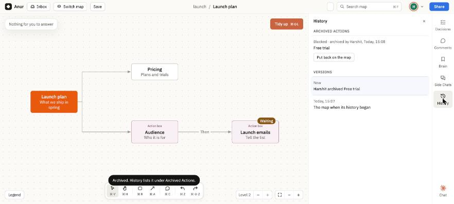
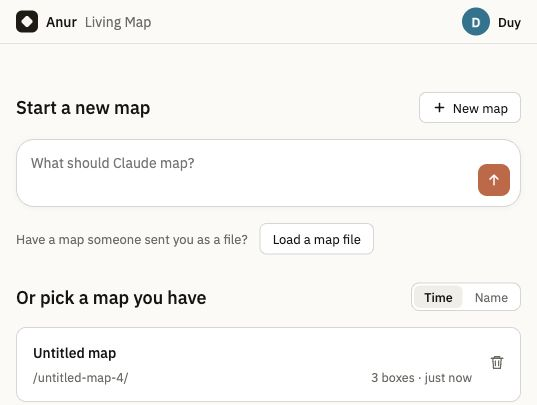
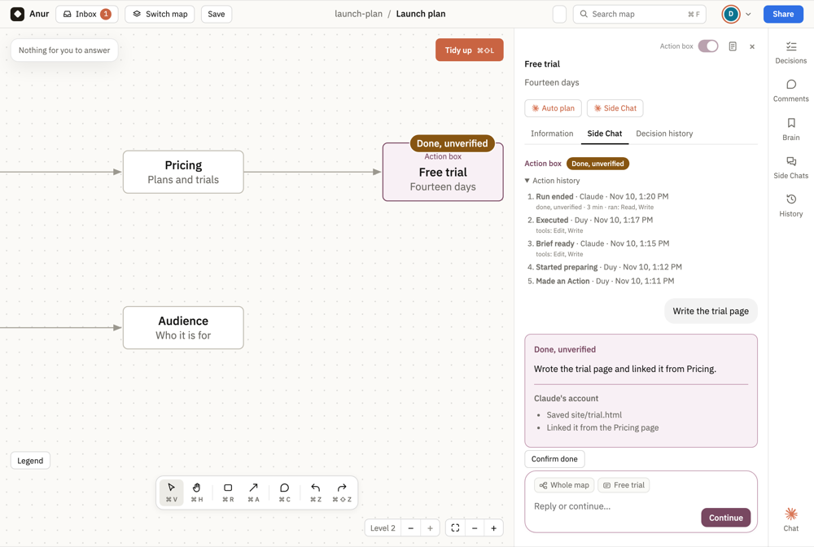
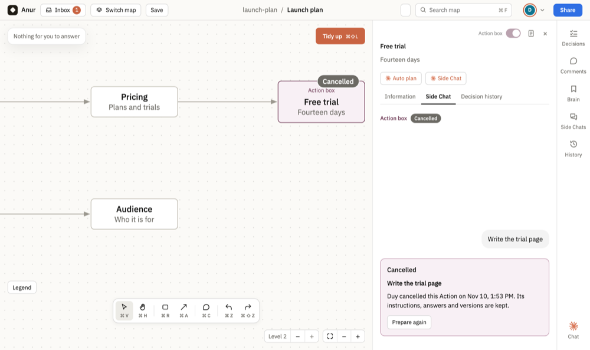
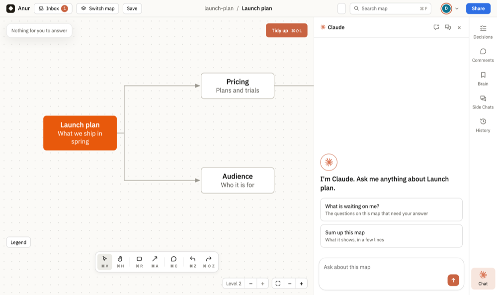
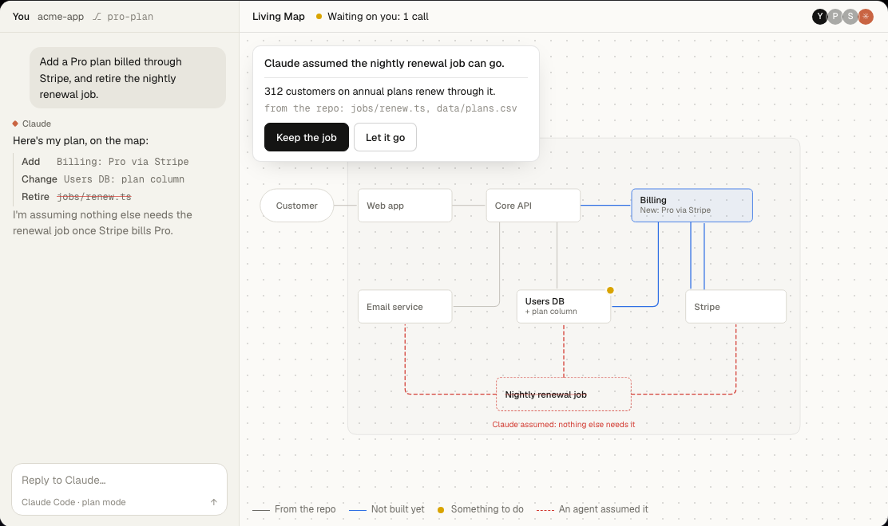

# Shipping log

New features and improvements to help you plan, work and share with Living Map. Update your app to get the latest changes.

<dl>
<dt><strong>🧹 [Layout cleanup] A clearer map</strong></dt>
<dd>

The questions card in the map's top-left and the Inbox are gone, so the map uses the whole screen; a question for you shows **Need clarify** on its box, and you answer it in the box's details. <!-- source: https://github.com/HiAnur/anur-living-map/pull/331 --> <!-- merged-at: 2026-11-10T23:23:46Z -->

</dd>
</dl>

<dl>
<dt><strong>🧹 [Layout cleanup] One way into a box's Side Chat</strong></dt>
<dd>

The Side Chat button beside **Auto plan** is gone; the box's **Side Chat** tab opens the chat on its newest message, ready for you to type. <!-- source: https://github.com/HiAnur/anur-living-map/pull/329 --> <!-- merged-at: 2026-11-10T23:15:07Z -->

</dd>
</dl>

<dl>
<dt><strong>✨ [New feature] Archive an Action once it has run</strong></dt>
<dd>

An Action's box can be deleted only before it runs, and only by its author or an Admin; after a run, **Archive this box** takes it off the map with its whole record, and **History** lists it under **Archived Actions** to put back. <!-- source: https://github.com/HiAnur/anur-living-map/pull/328 --> <!-- merged-at: 2026-11-10T23:12:21Z -->

</dd>
</dl>

<dl>
<dt><strong>Actions move forward when what they wait on is done</strong></dt>
<dd>

When the Actions an Action depends on finish, it prepares itself with what they produced and stops at **Ready to execute** for you. <!-- source: https://github.com/HiAnur/anur-living-map/pull/323 --> <!-- merged-at: 2026-11-10T22:41:43Z -->

</dd>
</dl>

<dl>
<dt><strong>✨ [New feature] Start a map without a prompt</strong></dt>
<dd>

On the home page, choose **+ New map** and start typing, then use Tab or Enter to build your map. <!-- source: https://github.com/HiAnur/anur-living-map/pull/322 --> <!-- merged-at: 2026-11-10T22:38:59Z -->

</dd>
</dl>

<dl>
<dt><strong>Hand an Action to someone else</strong></dt>
<dd>

An Admin can **Hand over** an Action to another member of the map, so it never waits on someone who is away. <!-- source: https://github.com/HiAnur/anur-living-map/pull/321 --> <!-- merged-at: 2026-11-10T22:35:48Z -->

</dd>
</dl>

<dl>
<dt><strong>✨ [New feature] Build Actions end in a pull request</strong></dt>
<dd>

A build Action works on its own branch, never in your checkout, and the map commits its changes, pushes the branch and opens the pull request for you. <!-- source: https://github.com/HiAnur/anur-living-map/pull/320 --> <!-- merged-at: 2026-11-10T22:27:41Z -->

</dd>
</dl>

<dl>
<dt><strong>✨ [New feature] An Action counts as done only when the map saw it</strong></dt>
<dd>

An Action shows **Executed** only when the map saw the run do the work, such as an email sent to the right recipient or a pull request GitHub confirms; otherwise it reads **Done, unverified**, with Claude's account shown apart, until you press **Confirm done**. <!-- source: https://github.com/HiAnur/anur-living-map/pull/318 --> <!-- merged-at: 2026-11-10T22:11:06Z -->

</dd>
</dl>

<dl>
<dt><strong>✨ [New feature] Every Action keeps its history</strong></dt>
<dd>

Open **Action history** on an Action to see each step, who took it and when, and the tools a run was given; the latest step also shows in the box's details. <!-- source: https://github.com/HiAnur/anur-living-map/pull/317 --> <!-- merged-at: 2026-11-10T22:02:15Z -->

</dd>
</dl>

<dl>
<dt><strong>Cancel an Action without losing it</strong></dt>
<dd>

**Cancel Action** sets an Action aside before it runs and keeps its instructions, answers and versions; **Prepare again** brings it back with its instructions. <!-- source: https://github.com/HiAnur/anur-living-map/pull/315 --> <!-- merged-at: 2026-11-10T21:53:24Z -->

</dd>
</dl>

<dl>
<dt><strong>Build the plan</strong></dt>
<dd>

The button that has Claude Code build an agreed plan now reads **Build the plan**, so it is not confused with an Action box's **Execute**, which runs one box's task. <!-- source: https://github.com/HiAnur/anur-living-map/pull/313 --> <!-- merged-at: 2026-11-10T21:38:50Z -->

</dd>
</dl>

<dl>
<dt><strong>Box details always say who changed a box</strong></dt>
<dd>

**Last edited by** in a box's details now names who made each change: the person, or Claude when an Action or the map changed the box in the background. <!-- source: https://github.com/HiAnur/anur-living-map/pull/311 --> <!-- merged-at: 2026-11-10T21:25:00Z -->

</dd>
</dl>

<dl>
<dt><strong>The Anur and Claude logos on the team map</strong></dt>
<dd>

The HiAnur logo now marks the browser tab of every team map page and the top left of the map and the list of maps, and Claude's own logo shows wherever the map shows Claude, from the **Chat** button to **Auto plan** and **Side Chat**. <!-- source: https://github.com/HiAnur/anur-living-map/pull/300 --> <!-- merged-at: 2026-11-10T20:29:07Z -->

</dd>
</dl>

<dl>
<dt><strong>Stay in control of what Actions can do</strong></dt>
<dd>

Review the tools an Action needs before you choose **Execute**. If it needs an additional tool beyond file reading and searching, it stops so you can revise the plan. <!-- source: https://github.com/HiAnur/anur-living-map/commit/62fc75b --> <!-- merged-at: 2026-11-10T07:33:12Z -->

</dd>
</dl>

<dl>
<dt><strong>✨ [New feature] Turn plans into reviewed Actions</strong></dt>
<dd>

**Auto plan** can add Actions with concrete tasks, prerequisites and readiness; review and prepare each Action before choosing **Execute**. The top-right **Info box / Action box** toggle leaves room for the title, status pills show progress, and **Revise** keeps earlier drafts as files in chat. In **Brain → Include other maps**, expand the checklist to choose extra context; other maps start unchecked. <!-- source: https://github.com/HiAnur/anur-living-map/pull/220 --> <!-- merged-at: 2026-11-10T00:20:28Z -->

</dd>
</dl>

<dl>
<dt><strong>Auto plan asks only when needed</strong></dt>
<dd>

**Auto plan** reads the whole map first and asks a specific question only when essential information is missing. <!-- source: https://github.com/HiAnur/anur-living-map/pull/216 --> <!-- merged-at: 2026-11-09T19:55:27Z -->

</dd>
</dl>

<dl>
<dt><strong>✨ [New feature] Relevant context from other maps</strong></dt>
<dd>

Choose which other maps Claude can use in **Brain → Include other maps**. Replies link to the maps they read, so you can check the source. <!-- source: https://github.com/HiAnur/anur-living-map/pull/208 --> <!-- source: https://github.com/HiAnur/anur-living-map/pull/214 --> <!-- merged-at: 2026-11-09T02:08:15Z -->

</dd>
</dl>

<dl>
<dt><strong>✨ [New feature] Sharing status in your map list</strong></dt>
<dd>

On the **home page**, right-aligned people and cloud icons show link sharing and online copies; hover over either for its meaning. <!-- source: https://github.com/HiAnur/anur-living-map/pull/204 --> <!-- source: https://github.com/HiAnur/anur-living-map/pull/206 --> <!-- merged-at: 2026-11-09T00:38:01Z -->

</dd>
</dl>

<dl>
<dt><strong>✨ [New feature] Browse every map in All brain</strong></dt>
<dd>

Browse your maps, decisions and saved context in **home → All brain**. Expand a map to inspect it, or choose **Open map** to work on it. <!-- source: https://github.com/HiAnur/anur-living-map/pull/178 --> <!-- source: https://github.com/HiAnur/anur-living-map/pull/183 --> <!-- source: https://github.com/HiAnur/anur-living-map/pull/202 --> <!-- merged-at: 2026-11-08T03:30:06Z -->

</dd>
</dl>

<dl>
<dt><strong>✨ [New feature] Trash and Restore</strong></dt>
<dd>

Use the trash icon on the home page to move a local map to **Trash**, then **Undo** or **Trash → Restore** to bring it back; code files and online copies stay intact, and older archived maps can also be restored. <!-- source: https://github.com/HiAnur/anur-living-map/pull/196 --> <!-- merged-at: 2026-11-08T03:17:45Z -->

</dd>
</dl>

<dl>
<dt><strong>✨ [New feature] See where a box came from</strong></dt>
<dd>

Open the document icon beside a box’s close button to see who created it, when it changed and its source chat when available. <!-- source: https://github.com/HiAnur/anur-living-map/pull/192 --> <!-- merged-at: 2026-11-08T03:05:33Z -->

</dd>
</dl>

<dl>
<dt><strong>✨ [New feature] Know when your map is shared online</strong></dt>
<dd>

Share shows **Local only** or **Shared online**, with a compact confirmation before uploading a cloud copy and copying its link. <!-- source: https://github.com/HiAnur/anur-living-map/pull/176 --> <!-- source: https://github.com/HiAnur/anur-living-map/pull/188 --> <!-- merged-at: 2026-11-08T02:25:30Z -->

</dd>
</dl>

<dl>
<dt><strong>✨ [New feature] Delete the online copy</strong></dt>
<dd>

Choose **Delete online copy** in Share to remove the shared map and disable its link. Your local map stays available. <!-- source: https://github.com/HiAnur/anur-living-map/pull/180 --> <!-- source: https://github.com/HiAnur/anur-living-map/pull/185 --> <!-- merged-at: 2026-11-08T02:22:44Z -->

</dd>
</dl>

<dl>
<dt><strong>✨ [New feature] Search your map</strong></dt>
<dd>

Search names, descriptions and notes with **Search map** (**⌘F / Ctrl+F**); **↑ ↓** previews each box, and **Enter** opens its Information panel. <!-- source: https://github.com/HiAnur/anur-living-map/pull/167 --> <!-- source: https://github.com/HiAnur/anur-living-map/pull/170 --> <!-- source: https://github.com/HiAnur/anur-living-map/pull/172 --> <!-- merged-at: 2026-11-08T01:32:10Z -->

</dd>
</dl>

<dl>
<dt><strong>🧹 [Layout cleanup] Proposals stay with their branch</strong></dt>
<dd>

Proposed topics append after existing children, with the preview showing where Apply will place them. <!-- source: https://github.com/HiAnur/anur-living-map/pull/161 --> <!-- merged-at: 2026-11-07T23:43:06Z -->

</dd>
</dl>

<dl>
<dt><strong>✨ [New feature] Edit descriptions on the map</strong></dt>
<dd>

Double-click a box’s title to rename it, or its description to edit that text in place. <!-- source: https://github.com/HiAnur/anur-living-map/pull/151 --> <!-- merged-at: 2026-11-07T19:48:37Z -->

</dd>
</dl>

<dl>
<dt><strong>🚀 [Major feature] Cloud sharing</strong></dt>
<dd>

With cloud sharing configured, **Share → Copy link** publishes your map so people can open it while your Mac is off; **Anyone with the link can** controls View or Edit. <!-- source: https://github.com/HiAnur/anur-living-map/pull/148 --> <!-- merged-at: 2026-11-07T19:35:22Z -->

Changes sync when your Mac reconnects, and **Turn off link** revokes access.

</dd>
</dl>

<dl>
<dt><strong>✨ [New feature] Edit topic names and line labels in place</strong></dt>
<dd>

Double-click box names or connection labels to edit them on the map, including proposed names before Apply. <!-- source: https://github.com/HiAnur/anur-living-map/pull/138 --> <!-- merged-at: 2026-11-07T18:51:15Z -->

</dd>
</dl>

<dl>
<dt><strong>🚀 [Major feature] Auto plan and planning feedback</strong></dt>
<dd>

Select a box and click **Auto plan** to preview connected topics with short descriptions before applying them. <!-- source: https://github.com/HiAnur/anur-living-map/pull/122 --> <!-- source: https://github.com/HiAnur/anur-living-map/pull/138 --> <!-- merged-at: 2026-11-07T18:51:15Z -->

Auto plan and Side Chat keep showing progress while Claude prepares changes. <!-- source: https://github.com/HiAnur/anur-living-map/pull/138 --> <!-- merged-at: 2026-11-07T18:51:15Z -->

</dd>
</dl>

<dl>
<dt><strong>✨ [New feature] Move branches together</strong></dt>
<dd>

Select several branches and drag them onto a new parent to move them together, with one floating preview and one destination hint. <!-- source: https://github.com/HiAnur/anur-living-map/pull/127 --> <!-- source: https://github.com/HiAnur/anur-living-map/pull/138 --> <!-- merged-at: 2026-11-07T18:51:15Z -->

</dd>
</dl>

<dl>
<dt><strong>🧹 [Layout cleanup] Compact map layout</strong></dt>
<dd>

Press **⌘⇧L** on Mac or **Ctrl+Shift+L** on Windows/Linux to run **Tidy up**, which reduces gaps between columns. <!-- source: https://github.com/HiAnur/anur-living-map/pull/132 --> <!-- source: https://github.com/HiAnur/anur-living-map/pull/138 --> <!-- merged-at: 2026-11-07T18:51:15Z -->

Boxes size to fit short titles and wrap longer names. <!-- source: https://github.com/HiAnur/anur-living-map/pull/108 --> <!-- source: https://github.com/HiAnur/anur-living-map/pull/133 --> <!-- merged-at: 2026-11-07T18:20:00Z -->

</dd>
</dl>

<dl>
<dt><strong>✨ [New feature] Editable box descriptions</strong></dt>
<dd>

Select a box, then double-click the description beneath its name in the right-hand panel to edit it. <!-- source: https://github.com/HiAnur/anur-living-map/pull/133 --> <!-- merged-at: 2026-11-07T18:20:00Z -->

</dd>
</dl>

<dl>
<dt><strong>🚀 [Major feature] Keyboard brainstorming</strong></dt>
<dd>

Press **⌘R**, then drag to draw a standalone box. <!-- source: https://github.com/HiAnur/anur-living-map/pull/130 --> <!-- merged-at: 2026-11-07T05:22:03Z -->

Select a box and press **Tab** for a connected subtopic or **Enter** for a sibling, then type to name it. <!-- source: https://github.com/HiAnur/anur-living-map/pull/104 --> <!-- source: https://github.com/HiAnur/anur-living-map/pull/106 --> <!-- source: https://github.com/HiAnur/anur-living-map/pull/118 --> <!-- merged-at: 2026-11-07T02:59:05Z -->

Arrow keys move between boxes and keep the selection in view. <!-- source: https://github.com/HiAnur/anur-living-map/pull/104 --> <!-- source: https://github.com/HiAnur/anur-living-map/pull/114 --> <!-- merged-at: 2026-11-07T02:01:43Z -->

</dd>
</dl>

<dl>
<dt><strong>🚀 [Major feature] View and edit links</strong></dt>
<dd>

In **Share**, choose **View** or **Edit** and click **Copy link** to control what the link allows. <!-- source: https://github.com/HiAnur/anur-living-map/pull/125 --> <!-- merged-at: 2026-11-07T05:14:56Z -->

</dd>
</dl>

<dl>
<dt><strong>✨ [New feature] Project access</strong></dt>
<dd>

Owners can remove someone’s signed-in project access in **Share**. <!-- source: https://github.com/HiAnur/anur-living-map/pull/120 --> <!-- source: https://github.com/HiAnur/anur-living-map/pull/123 --> <!-- merged-at: 2026-11-07T04:44:52Z -->

</dd>
</dl>

<dl>
<dt><strong>✨ [New feature] Password recovery by email</strong></dt>
<dd>

Once you verify a recovery email, **Forgot password?** on the sign-in page can send you a reset link. <!-- source: https://github.com/HiAnur/anur-living-map/pull/111 --> <!-- merged-at: 2026-11-07T04:38:42Z -->

</dd>
</dl>

<dl>
<dt><strong>✨ [New feature] Undo, redo, and branch deletion</strong></dt>
<dd>

After deleting a child box, the selection moves to a nearby sibling before returning to the parent. <!-- source: https://github.com/HiAnur/anur-living-map/pull/119 --> <!-- merged-at: 2026-11-07T03:05:14Z -->

Use **Undo** and **Redo** in the map toolbar, or confirm a parent’s deletion to remove its whole branch. <!-- source: https://github.com/HiAnur/anur-living-map/pull/112 --> <!-- source: https://github.com/HiAnur/anur-living-map/pull/117 --> <!-- merged-at: 2026-11-07T02:31:39Z -->

Box details show creation and update dates. <!-- source: https://github.com/HiAnur/anur-living-map/pull/117 --> <!-- merged-at: 2026-11-07T02:31:39Z -->

</dd>
</dl>

<dl>
<dt><strong>✨ [New feature] Export a map as an image</strong></dt>
<dd>

Use **Share → Download PNG** to save the full current map view, including boxes beyond the screen. <!-- source: https://github.com/HiAnur/anur-living-map/pull/110 --> <!-- merged-at: 2026-11-07T01:19:47Z -->

</dd>
</dl>

<dl>
<dt><strong>Smoother trackpad zoom</strong></dt>
<dd>

Pinch to zoom in smaller steps on a trackpad. <!-- source: https://github.com/HiAnur/anur-living-map/pull/107 --> <!-- merged-at: 2026-11-07T00:23:38Z -->

</dd>
</dl>

<dl>
<dt><strong>✨ [New feature] Sign back into Claude from Side Chat</strong></dt>
<dd>

If Claude Code is signed out, click **Sign in** on the Side Chat reply to reconnect in your browser. <!-- source: https://github.com/HiAnur/anur-living-map/pull/100 --> <!-- merged-at: 2026-11-04T21:11:12Z -->

</dd>
</dl>

<dl>
<dt><strong>🧹 [Layout cleanup] Claude can propose a tidier map</strong></dt>
<dd>

Ask Claude to reorganize a team map, then click **Apply** to arrange its branches around a starting box. <!-- source: https://github.com/HiAnur/anur-living-map/pull/93 --> <!-- merged-at: 2026-11-04T00:00:19Z -->

</dd>
</dl>

<dl>
<dt><strong>✨ [New feature] Share a map as a file</strong></dt>
<dd>

Download a map from **Share** to open it on its own in a browser, or click **Load into Living Map** to bring it back. <!-- source: https://github.com/HiAnur/anur-living-map/pull/91 --> <!-- source: https://github.com/HiAnur/anur-living-map/pull/92 --> <!-- merged-at: 2026-11-03T04:30:19Z -->

</dd>
</dl>

<dl>
<dt><strong>✨ [New feature] Draw and select boxes on the canvas</strong></dt>
<dd>

Drag across empty space to select several boxes together. <!-- source: https://github.com/HiAnur/anur-living-map/pull/87 --> <!-- merged-at: 2026-11-03T03:46:00Z -->

Drag a dot from a box to another box to connect them, or release on empty canvas to create a connected box. <!-- source: https://github.com/HiAnur/anur-living-map/pull/85 --> <!-- merged-at: 2026-11-03T03:28:52Z -->

</dd>
</dl>

<dl>
<dt><strong>✨ [New feature] One-click app updates</strong></dt>
<dd>

For copies installed from GitHub, click **Update** in the top bar when a new version is available. <!-- source: https://github.com/HiAnur/anur-living-map/pull/77 --> <!-- source: https://github.com/HiAnur/anur-living-map/pull/83 --> <!-- merged-at: 2026-11-03T03:21:59Z -->

</dd>
</dl>

<dl>
<dt><strong>🚀 [Major feature] Shared maps for codebases</strong></dt>
<dd>

Run `/anur-living-map` in Claude Code to open a shared repo map where your team can review plans and resolve decisions. <!-- source: https://github.com/HiAnur/anur-living-map/pull/57 --> <!-- source: https://github.com/HiAnur/anur-living-map/pull/59 --> <!-- merged-at: 2026-11-02T22:19:54Z -->

</dd>
</dl>
