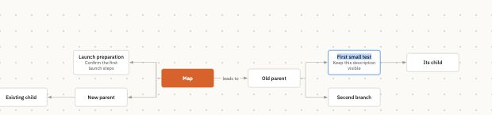
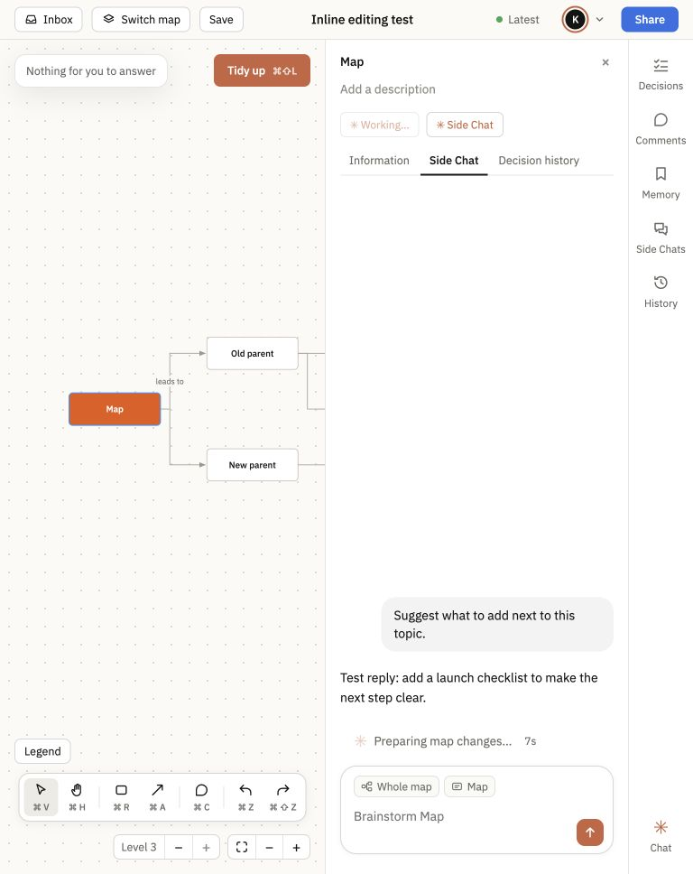
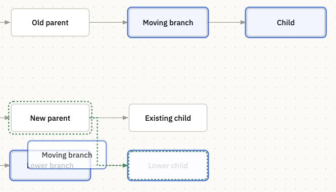
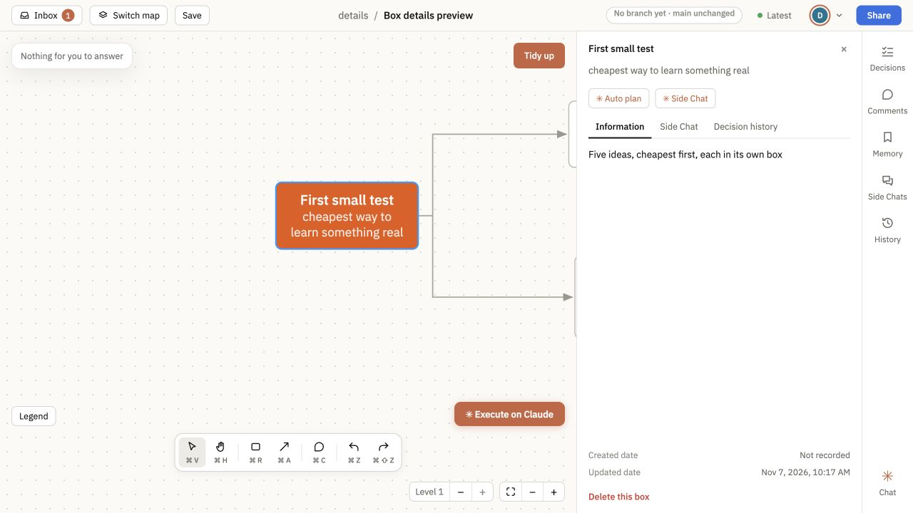

# Shipping log

Changes merged into Living Map, newest first. Dates use America/Los_Angeles. Installed copies receive these changes when they update.

## November 7, 2026

- **✨ Edit topic names and line labels in place**

  - Double-click box names or connection labels to edit them on the map, including proposed names before Apply. [#138](https://github.com/HiAnur/anur-living-map/pull/138) <!-- merged-at: 2026-11-07T18:51:15Z -->

    

- **✨ Clearer planning progress and descriptions**

  - Auto plan and Side Chat show when Claude is still working. New planned topics include short descriptions. [#138](https://github.com/HiAnur/anur-living-map/pull/138) <!-- merged-at: 2026-11-07T18:51:15Z -->

    

- **🧹 One preview for a group drag**

  - Dragging several boxes shows one preview and destination hint. All selected branches move together. [#138](https://github.com/HiAnur/anur-living-map/pull/138) <!-- merged-at: 2026-11-07T18:51:15Z -->

    

- **✨ Tidy up shortcut**

  - Press ⌘⇧L on Mac or Ctrl+Shift+L on Windows/Linux to tidy the map. [#138](https://github.com/HiAnur/anur-living-map/pull/138) <!-- merged-at: 2026-11-07T18:51:15Z -->

- **✨ Editable box descriptions**

  - Select a box, then double-click the description beneath its name in the right-hand panel to edit it. [Change #133](https://github.com/HiAnur/anur-living-map/pull/133) <!-- merged-at: 2026-11-07T18:20:00Z -->

    

- **🧹 Layout fixes**

  - Short box titles fit on one line. [#133](https://github.com/HiAnur/anur-living-map/pull/133) <!-- merged-at: 2026-11-07T18:20:00Z -->
  - Tidy up reduces gaps between columns. [#132](https://github.com/HiAnur/anur-living-map/pull/132) <!-- merged-at: 2026-11-07T18:12:46Z -->

## November 6, 2026

- **Box drawing shortcut restored**

  - Press ⌘R, then drag to draw a box. [#130](https://github.com/HiAnur/anur-living-map/pull/130) <!-- merged-at: 2026-11-07T05:22:03Z -->
