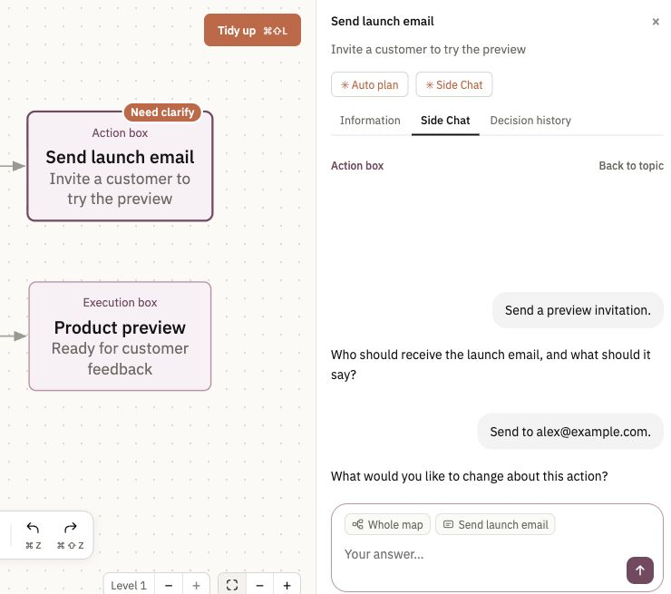
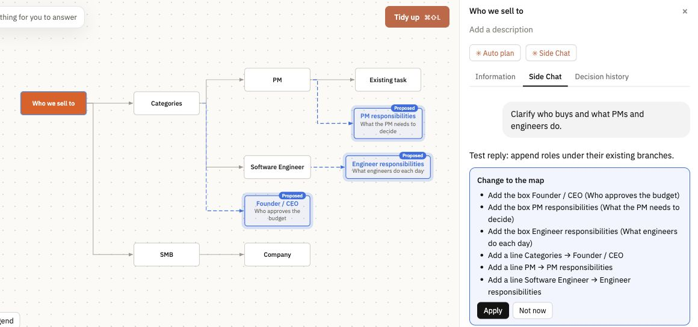
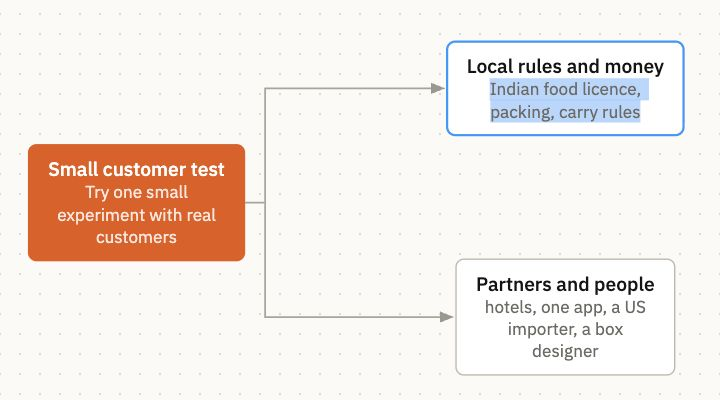
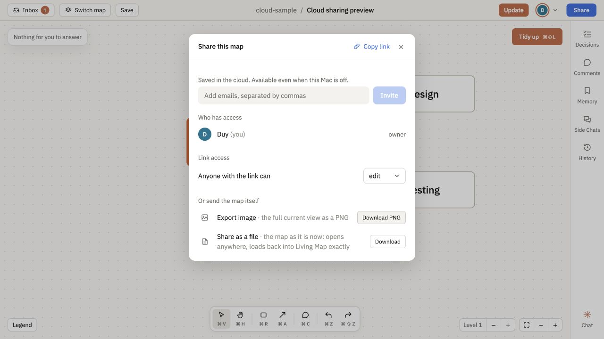
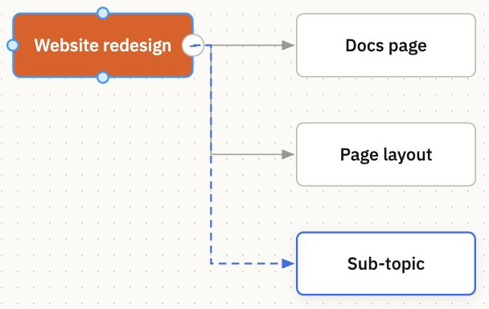
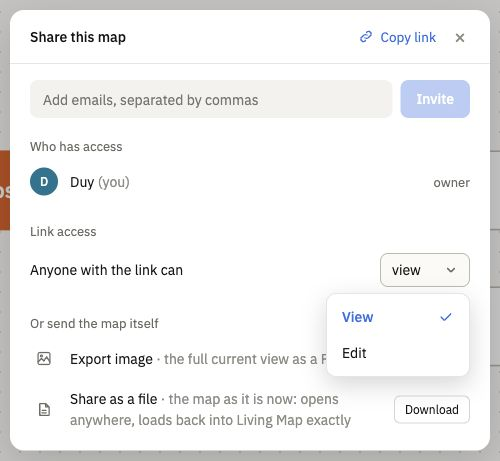

# Shipping log

Recent changes you can use in the current release of Living Map, newest first. Dates use America/Los_Angeles. Installed copies receive these changes when they update.

## November 7, 2026

<dl>
<dt><strong>✨ [New feature] Action boxes in Side Chat</strong></dt>
<dd>

Choose **Action box**, write your task in **Side Chat**, answer clarifications with **Enter**, then review and **Execute** in Claude. Plum boxes show spinning progress or a **Need clarify** pill. [#164](https://github.com/HiAnur/anur-living-map/pull/164), [#166](https://github.com/HiAnur/anur-living-map/pull/166) <!-- merged-at: 2026-11-08T00:08:33Z -->

</dd>
</dl>

<dl>
<dt><strong>🧹 [Layout cleanup] Proposals stay with their branch</strong></dt>
<dd>

Proposed topics append after existing children, with the preview showing where Apply will place them. [#161](https://github.com/HiAnur/anur-living-map/pull/161) <!-- merged-at: 2026-11-07T23:43:06Z -->

</dd>
</dl>

<dl>
<dt><strong>Auto plan asks for your goal first</strong></dt>
<dd>

Auto plan asks what you want to achieve before using the whole map to find gaps in the selected branch. [#161](https://github.com/HiAnur/anur-living-map/pull/161) <!-- merged-at: 2026-11-07T23:43:06Z -->

</dd>
</dl>

<dl>
<dt><strong>Claude's map tools work again after sign-in</strong></dt>
<dd>

The living_map_read and living_map_change tools in your Claude chats, and the map's listener, reach the map server again instead of being refused as signed out. [#147](https://github.com/HiAnur/anur-living-map/pull/147) <!-- merged-at: 2026-11-07T19:34:30Z -->

</dd>
</dl>

<dl>
<dt><strong>Copy links with placeholders in map text</strong></dt>
<dd>

**Share → Copy link** now accepts notes such as `maps/<name>/state.json` and preserves special characters in shared boxes, lines and comments. [#153](https://github.com/HiAnur/anur-living-map/pull/153) <!-- merged-at: 2026-11-07T19:55:09Z -->

</dd>
</dl>

<dl>
<dt><strong>✨ [New feature] Edit descriptions on the map</strong></dt>
<dd>

Double-click a box’s title to rename it, or its description to edit that text in place. [#151](https://github.com/HiAnur/anur-living-map/pull/151) <!-- merged-at: 2026-11-07T19:48:37Z -->

</dd>
</dl>

<dl>
<dt><strong>🧹 [Layout cleanup] Aligned branch lines</strong></dt>
<dd>

Two-child branches share one vertical stem, even when their boxes have different widths. [#151](https://github.com/HiAnur/anur-living-map/pull/151) <!-- merged-at: 2026-11-07T19:48:37Z -->

</dd>
</dl>

<dl>
<dt><strong>🚀 [Major feature] Cloud sharing</strong></dt>
<dd>

With cloud sharing configured, **Share → Copy link** publishes your map so people can open it while your Mac is off; **Anyone with the link can** controls View or Edit. [#148](https://github.com/HiAnur/anur-living-map/pull/148) <!-- merged-at: 2026-11-07T19:35:22Z -->

Changes sync when your Mac reconnects, and **Turn off link** revokes access.

</dd>
</dl>

<dl>
<dt><strong>✨ [New feature] Shipping log on the website</strong></dt>
<dd>

Open **Shipping log** in the Living Map website sidebar to read the latest entries from GitHub. [Website update](https://github.com/HiAnur/hianur.com/commit/12ddc03) <!-- merged-at: 2026-11-07T18:56:21Z -->

</dd>
</dl>

<dl>
<dt><strong>✨ [New feature] Edit topic names and line labels in place</strong></dt>
<dd>

Double-click box names or connection labels to edit them on the map, including proposed names before Apply. [#138](https://github.com/HiAnur/anur-living-map/pull/138) <!-- merged-at: 2026-11-07T18:51:15Z -->

</dd>
</dl>

<dl>
<dt><strong>🚀 [Major feature] Auto plan and planning feedback</strong></dt>
<dd>

Select a box and click **Auto plan** to preview connected topics with short descriptions before applying them. [#122](https://github.com/HiAnur/anur-living-map/pull/122) · [#138](https://github.com/HiAnur/anur-living-map/pull/138) <!-- merged-at: 2026-11-07T18:51:15Z -->

Auto plan and Side Chat keep showing progress while Claude prepares changes. [#138](https://github.com/HiAnur/anur-living-map/pull/138) <!-- merged-at: 2026-11-07T18:51:15Z -->

</dd>
</dl>

<dl>
<dt><strong>✨ [New feature] Move branches together</strong></dt>
<dd>

Select several branches and drag them onto a new parent to move them together, with one floating preview and one destination hint. [#127](https://github.com/HiAnur/anur-living-map/pull/127) · [#138](https://github.com/HiAnur/anur-living-map/pull/138) <!-- merged-at: 2026-11-07T18:51:15Z -->

</dd>
</dl>

<dl>
<dt><strong>🧹 [Layout cleanup] Compact map layout</strong></dt>
<dd>

Press **⌘⇧L** on Mac or **Ctrl+Shift+L** on Windows/Linux to run **Tidy up**, which reduces gaps between columns. [#132](https://github.com/HiAnur/anur-living-map/pull/132) · [#138](https://github.com/HiAnur/anur-living-map/pull/138) <!-- merged-at: 2026-11-07T18:51:15Z -->

Boxes size to fit short titles and wrap longer names. [#108](https://github.com/HiAnur/anur-living-map/pull/108) · [#133](https://github.com/HiAnur/anur-living-map/pull/133) <!-- merged-at: 2026-11-07T18:20:00Z -->

</dd>
</dl>

<dl>
<dt><strong>✨ [New feature] Editable box descriptions</strong></dt>
<dd>

Select a box, then double-click the description beneath its name in the right-hand panel to edit it. [Change #133](https://github.com/HiAnur/anur-living-map/pull/133) <!-- merged-at: 2026-11-07T18:20:00Z -->

</dd>
</dl>

## November 6, 2026

<dl>
<dt><strong>🚀 [Major feature] Keyboard brainstorming</strong></dt>
<dd>

Press **⌘R**, then drag to draw a standalone box. [#130](https://github.com/HiAnur/anur-living-map/pull/130) <!-- merged-at: 2026-11-07T05:22:03Z -->

Select a box and press **Tab** for a connected subtopic or **Enter** for a sibling, then type to name it. [#104](https://github.com/HiAnur/anur-living-map/pull/104) · [#106](https://github.com/HiAnur/anur-living-map/pull/106) · [#118](https://github.com/HiAnur/anur-living-map/pull/118) <!-- merged-at: 2026-11-07T02:59:05Z -->

Arrow keys move between boxes and keep the selection in view. [#104](https://github.com/HiAnur/anur-living-map/pull/104) · [#114](https://github.com/HiAnur/anur-living-map/pull/114) <!-- merged-at: 2026-11-07T02:01:43Z -->

</dd>
</dl>

<dl>
<dt><strong>🚀 [Major feature] View and edit links</strong></dt>
<dd>

In **Share**, choose **View** or **Edit** and click **Copy link** to control what the link allows. [#125](https://github.com/HiAnur/anur-living-map/pull/125) <!-- merged-at: 2026-11-07T05:14:56Z -->

</dd>
</dl>

<dl>
<dt><strong>✨ [New feature] Project access</strong></dt>
<dd>

Owners can remove someone’s signed-in project access in **Share**. [#120](https://github.com/HiAnur/anur-living-map/pull/120) · [#123](https://github.com/HiAnur/anur-living-map/pull/123) <!-- merged-at: 2026-11-07T04:44:52Z -->

</dd>
</dl>

<dl>
<dt><strong>✨ [New feature] Password recovery by email</strong></dt>
<dd>

Once you verify a recovery email, **Forgot password?** on the sign-in page can send you a reset link. [#111](https://github.com/HiAnur/anur-living-map/pull/111) <!-- merged-at: 2026-11-07T04:38:42Z -->

</dd>
</dl>

<dl>
<dt><strong>✨ [New feature] Undo, redo, and branch deletion</strong></dt>
<dd>

After deleting a child box, the selection moves to a nearby sibling before returning to the parent. [#119](https://github.com/HiAnur/anur-living-map/pull/119) <!-- merged-at: 2026-11-07T03:05:14Z -->

Use **Undo** and **Redo** in the map toolbar, or confirm a parent’s deletion to remove its whole branch. [#112](https://github.com/HiAnur/anur-living-map/pull/112) · [#117](https://github.com/HiAnur/anur-living-map/pull/117) <!-- merged-at: 2026-11-07T02:31:39Z -->

Box details show creation and update dates. [#117](https://github.com/HiAnur/anur-living-map/pull/117) <!-- merged-at: 2026-11-07T02:31:39Z -->

</dd>
</dl>

<dl>
<dt><strong>✨ [New feature] Export a map as an image</strong></dt>
<dd>

Use **Share → Download PNG** to save the full current map view, including boxes beyond the screen. [#110](https://github.com/HiAnur/anur-living-map/pull/110) <!-- merged-at: 2026-11-07T01:19:47Z -->

</dd>
</dl>

<dl>
<dt><strong>Smoother trackpad zoom</strong></dt>
<dd>

Pinch to zoom in smaller steps on a trackpad. [#107](https://github.com/HiAnur/anur-living-map/pull/107) <!-- merged-at: 2026-11-07T00:23:38Z -->

</dd>
</dl>

## November 4, 2026

<dl>
<dt><strong>✨ [New feature] Sign back into Claude from Side Chat</strong></dt>
<dd>

If Claude Code is signed out, click **Sign in** on the Side Chat reply to reconnect in your browser. [#100](https://github.com/HiAnur/anur-living-map/pull/100) <!-- merged-at: 2026-11-04T21:11:12Z -->

</dd>
</dl>

## November 3, 2026

<dl>
<dt><strong>🧹 [Layout cleanup] Claude can propose a tidier map</strong></dt>
<dd>

Ask Claude to reorganize a team map, then click **Apply** to arrange its branches around a starting box. [#93](https://github.com/HiAnur/anur-living-map/pull/93) <!-- merged-at: 2026-11-04T00:00:19Z -->

</dd>
</dl>

## November 2, 2026

<dl>
<dt><strong>✨ [New feature] Share a map as a file</strong></dt>
<dd>

Download a map from **Share** to open it on its own in a browser, or click **Load into Living Map** to bring it back. [#91](https://github.com/HiAnur/anur-living-map/pull/91) · [#92](https://github.com/HiAnur/anur-living-map/pull/92) <!-- merged-at: 2026-11-03T04:30:19Z -->

</dd>
</dl>

<dl>
<dt><strong>✨ [New feature] Draw and select boxes on the canvas</strong></dt>
<dd>

Drag across empty space to select several boxes together. [#87](https://github.com/HiAnur/anur-living-map/pull/87) <!-- merged-at: 2026-11-03T03:46:00Z -->

Drag a dot from a box to another box to connect them, or release on empty canvas to create a connected box. [#85](https://github.com/HiAnur/anur-living-map/pull/85) <!-- merged-at: 2026-11-03T03:28:52Z -->

</dd>
</dl>

<dl>
<dt><strong>✨ [New feature] One-click app updates</strong></dt>
<dd>

If you installed with `git clone`, click **Update** in the top bar when a new version is available. [#77](https://github.com/HiAnur/anur-living-map/pull/77) · [#83](https://github.com/HiAnur/anur-living-map/pull/83) <!-- merged-at: 2026-11-03T03:21:59Z -->

</dd>
</dl>

<dl>
<dt><strong>🚀 [Major feature] Shared maps for codebases</strong></dt>
<dd>

Run `/anur-living-map` in Claude Code to open a shared repo map where your team can review plans and resolve decisions. [#57](https://github.com/HiAnur/anur-living-map/pull/57) · [#59](https://github.com/HiAnur/anur-living-map/pull/59) <!-- merged-at: 2026-11-02T22:19:54Z -->

</dd>
</dl>
