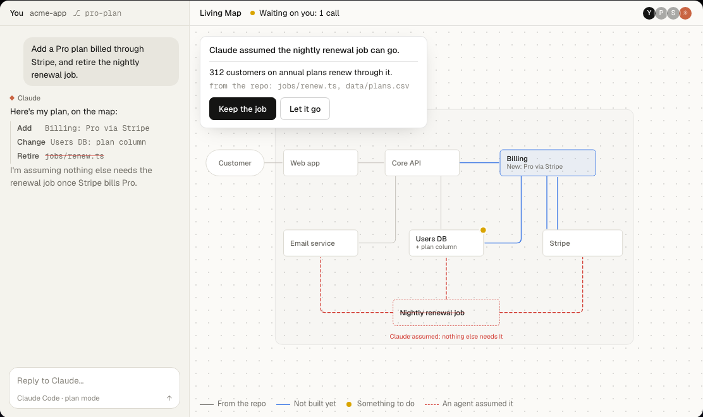

<p align="center"></p>

<p align="center"><b>The map your engineers decide on and your AI agents build from.</b><br>
Claude Code plans a feature on your real system before any code. The team confirms or disputes each call in a click. The agent builds from what was agreed.</p>

<p align="center"><a href="https://heyanur.ai/living-map"></a><br>
<a href="https://heyanur.ai/living-map">Try it: Claude plans, you decide.</a></p>

## Use it

You need [Node.js](https://nodejs.org) 22 or later and [Claude Code](https://claude.com/claude-code) or [Pi](https://pi.dev) signed in.

```bash
git clone https://github.com/HiAnur/anur-living-map.git ~/anur-living-map
cp -R ~/anur-living-map/team/skill/anur-living-map ~/.claude/skills/
claude mcp add --scope user anur-living-map -- node ~/anur-living-map/team/live/mcp.js
```

With Pi, copy the skill where Pi reads it instead; the first `/skill:anur-living-map` adds the map's tools and listener to Pi and asks you to type `/reload` once:

```bash
git clone https://github.com/HiAnur/anur-living-map.git ~/anur-living-map
mkdir -p ~/.agents/skills && cp -R ~/anur-living-map/team/skill/anur-living-map ~/.agents/skills/
```

Then, in a Claude Code chat inside any repo, type **/anur-living-map** (in Pi, **/skill:anur-living-map**). It starts the map server on port `4323` if none answers, puts that repo on the list of maps, opens `http://localhost:4323/<repo folder name>/` beside the chat and links the chat to it. `/anur-living-map, plan <a feature>` has Claude draw its plan on the map before writing any code. The first time, sign in as yourself; the map's people are the repo's team.

- **Boxes come from the repo:** its folders, imports and settings, so the map is the system as it is.
- **A plan is ink on top of it:** new parts in blue, changes with a dot, and a dashed box where the agent assumed something nobody has confirmed.
- **Each call is a click:** Confirm or Dispute on the box, ask a teammate a question, press Build the plan when the plan is agreed. The answer reaches the agent's chat at once, in your words, with your name and the date.
- **Every agent after reads it:** the next chat, yours or a teammate's, starts from what the team decided; what it builds lands back on the map, and History keeps every version.
- **Any chat can draw on it:** `living_map_read` and `living_map_change` are the two tools from `team/live/mcp.js`.

The map's own work (answering on a box, preparing and running an Action, drawing a system map) runs on the agent whose chat started the server; `LIVING_MAP_AGENT=claude` or `pi` picks one. Chats from both agents can open and hear the same map.

Everything runs on your machine. Clone somewhere else? Set `ANUR_LIVING_MAP_HOME` to that folder. Sign-in, Google sign-in for a team, and the list of maps: [team/README.md](team/README.md).

## The chat map (retired)

The older Living Map drew one Claude Code chat as a mind map beside it (`/living-map`). It is retired: use Anur Living Map above. If you have it installed, `node skill/uninstall.ts` in its folder removes it, and asks before deleting its data. More in [docs/chat-map.md](docs/chat-map.md).

## What changed

Read the [Shipping log](CHANGELOG.md) for concise feature and fix updates, with screenshots for bigger changes.

## Contributing

Issues and pull requests are welcome. See [CONTRIBUTING.md](CONTRIBUTING.md) for setup, the checks every change must pass, and the code conventions, and [AGENTS.md](AGENTS.md) for how the code fits together.

## Security

Both servers listen on `127.0.0.1` only. The chat map's API needs a local token kept in `~/.living-map/token`, readable only by you; the team map's API is open to this Mac's own tools, and its pages ask you to sign in (see [team/live/README.md](team/live/README.md)). See [SECURITY.md](SECURITY.md) to report a problem.

## License

[MIT](LICENSE)
